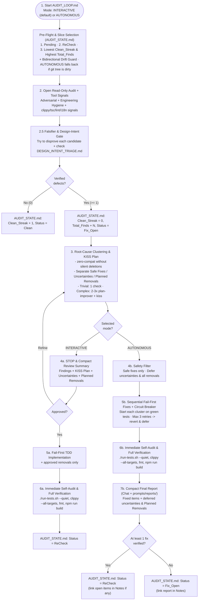

# 🤖 HuMoCo App Universal Audit & Improvement Loop

> **Credo:** *"Trust people, verify math."*  
> **Doctrine:** *"Open-minded review, root-cause fixes, zero blind deletions — 100% coverage with persistent memory."*

This directory contains the self-orchestrating AI quality and security review system for `human-money-app`. It combines an open-ended adversarial/hygiene audit, an active falsifier gate, root-cause KISS plan refinement, and two explicit operating modes (`INTERACTIVE` and `AUTONOMOUS`) backed by a persistent coverage ledger.

---

## 🗂️ Structure

* **[`AUDIT_LOOP.md`](AUDIT_LOOP.md)**: **The ONE prompt.** Compact, open-ended review prompt supporting `INTERACTIVE` *(default)* and `AUTONOMOUS` modes, bidirectional drift detection, falsifier + design-intent filtering, root-cause KISS planning (`plan-improver` + `kiss`), circuit-breaker safety, and fail-first verification.
* **[`AUDIT_STATE.md`](AUDIT_STATE.md)**: **The audit memory (coverage ledger).** Maps 100% of app source and security config files (`crates/humoco-market/src/`, `src-tauri/src/`, production `src/`, `src-tauri/tauri.conf.json`, `src-tauri/capabilities/default.json`) across `S01`–`S20` plus cross-slice E2E & QS-blindspot slice `S21`, tracking `Clean_Streak`, `Total_Finds`, `Last_Run`, `Status`, and `Notes`.
* **[`../docs/security/DESIGN_INTENT_TRIAGE.md`](../docs/security/DESIGN_INTENT_TRIAGE.md)**: **Active false-positive filter.** Documents intentional thin-bridge, Quick-PIN/Cashier, Zero-Config Sync-Lock, Social Recovery, Simple/Expert UX, and HTML5 drop invariants so audits never break core wallet architecture. *(Complementary visual UI tour & console audit instructions live in [`../docs/UI_AUDIT_GUIDE.md`](../docs/UI_AUDIT_GUIDE.md).)*
* **[`reports/`](reports/)**: Compact reports written by `AUTONOMOUS` runs whenever uncertainties, circuit-breaker deferrals, or planned removals require human review.

---

## 🚀 How to Run the Loop

### Mode A — `INTERACTIVE` *(Default: Plan & Approval Gate)*
Stops after findings, root-cause clustering, and `plan-improver` + `kiss` refinement with a compact summary, a dedicated **Planned Removals** list, and any open questions before touching code:
> *"Run the audit loop: @prompts/AUDIT_LOOP.md"*

Also works cleanly for non-interactive CLI runs (the output acts as a self-contained review & fix plan):
```bash
opencode run --file prompts/AUDIT_LOOP.md
model-router run "$(cat prompts/AUDIT_LOOP.md)"
```

### Mode B — `AUTONOMOUS` *(End-to-End Safe Fixes, Deferred Uncertainties)*
Executes unambiguous fixes on one slice without pausing (requires a clean `git` tree, uses a max-3-attempt circuit breaker per fix cluster, never executes unapproved deletions, and collects any uncertainties/removals into `prompts/reports/`):
> *"Run @prompts/AUDIT_LOOP.md in AUTONOMOUS mode"*

*(Optionally target a specific slice: `"Run @prompts/AUDIT_LOOP.md on S04"`.)*

---

## 🔄 Two-Mode Closed-Loop Lifecycle


